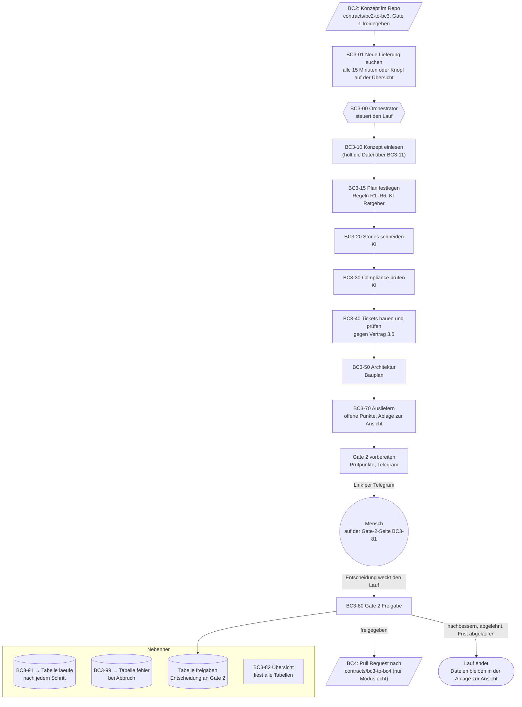

# Ablauf des BC3-Slicers

Von der Lieferung von BC2 bis zur Übergabe an BC4. Stand 23.10.2026.

## Kurz

- Ein Lauf hat neun Schritte: BC3-10, BC3-15, BC3-20, BC3-30, BC3-40, BC3-50, BC3-70, Gate 2, BC3-80.
- KI arbeitet nur in drei Schritten: BC3-15 (Ratgeber, ändert nichts), BC3-20 (Stories) und BC3-30 (Compliance). Alles andere sind feste Regeln.
- Ein Mensch entscheidet nur an Gate 2. Ohne Entscheidung endet der Lauf nach 7 Tagen mit `frist_abgelaufen`.
- Modus `test`: kein Pull Request an BC4. Modus `echt`: nach der Freigabe an Gate 2 Pull Request nach `contracts/bc3-to-bc4/`, von BC3 zusammengeführt. Erste echte Lieferung am 23.10.2026 (KP-05, PR #337).

## Bild

## Schritte

| Nr. | Schritt | Was reinkommt | Was rauskommt | KI | Wohin geschrieben |
|---|---|---|---|---|---|
| 0 | **BC3-01** Neue Lieferung suchen | Dateiliste `contracts/bc2-to-bc3/lieferungen/` auf `main`, `gate1.status`, bekannte Läufe | je neuem Konzept ein Start von BC3-00, nur freigegebene Potenziale | nein | – |
| – | **BC3-00** Orchestrator | Pfad der Konzeptdatei | ruft die Schritte nacheinander auf, hält an Gate 2 an, schreibt den Abschlussbericht | nein | über BC3-91 in `laeufe` |
| 1 | **BC3-10** Konzept einlesen (mit BC3-11) | Konzeptdatei aus GitHub | Potenziale mit Anforderungen (A), Akzeptanzkriterien (K), Vorgaben (V); Eingangsprüfung | nein | – |
| 2 | **BC3-15** Plan festlegen | Potenziale, Anbindungen, Herkunft der Zahlen | Plan: welche Stufe in welchem Modus (R1–R6); Hochrisiko-Regel für alle acht Bereiche aus Anhang III; Hinweise des Ratgebers | nur Ratgeber (`mistral-medium-3-5`), ändert den Plan nicht | – |
| 3 | **BC3-20** Stories schneiden | Potenziale | je Potenzial ein Epic mit Stories und Akzeptanzkriterien, Abdeckung von A, K, V; Messverfahren nur aus dem Konzept | ja (`mistral-large-2512`, Temperatur 0, Seed 42) | – |
| 4 | **BC3-30** Compliance prüfen | Epics, Datenarten, Tragweite | Ampel, Risikoklasse nach KI-VO, Pflichten mit Adressat, Zusatz-Stories, Zuordnung zu vorhandenen Stories | ja (`mistral-large-2512`, Temperatur 0, Seed 42) | – |
| 5 | **BC3-40** Tickets bauen und prüfen | Epics, Compliance-Befund | `tickets.json`, `compliance-audit.json`, geprüft gegen Schema 3.5; doppelte Compliance-Stories werden nicht angehängt; bricht ab, wenn etwas nicht passt | nein | – |
| 6 | **BC3-50** Architektur | Tickets | `architecture.md` (Mermaid), `blueprint.json` mit menschlichen Entscheidungspunkten; API-Teil abgeschaltet | nein | – |
| 7 | **BC3-70** Ausliefern | alle Dateien des Laufs | `offene-punkte.json` (was offen ist und für wen, bleibt bei BC3), fünf Dateien zur Ansicht, je Lieferung ein Ordner | nein | Ablage zur Ansicht |
| 8 | **Gate 2** (BC3-00, BC3-81) | Umschlag des Laufs | fünf maschinelle Prüfpunkte, drei Akzeptanzkriterien zur Stichprobe, Telegram mit Link; die Seite zeigt Eingang, Schritte, Ergebnis, Ausgang | nein | `gate2_ansicht` |
| 9 | **BC3-80** Gate 2 Freigabe | Entscheidung, Begründung | Entscheidung festgehalten; bei Freigabe im Modus `echt` Pull Request mit vier Dateien (`ticket_set.json`, `compliance-audit.json`, `architecture.md`, `blueprint.json`) nach `contracts/bc3-to-bc4/<projekt>/<lieferung>/`, von BC3 zusammengeführt, Zeile in `bc3.lieferungen` | nein | `freigaben`, GitHub, Team-Datenbank |

## Was nebenher läuft

- **BC3-91 Laufprotokoll:** schreibt nach jedem Schritt den Stand in eine Zeile in `laeufe` (Status `laeuft`, `wartet_gate2`, `freigegeben`, `nachbessern`, `abgelehnt`, `abgebrochen`), mit Dauer und Kosten.
- **BC3-99 Fehlerprotokoll:** schreibt jeden Abbruch in `fehler`, getrennt nach gewollter Prüfung (`pruefung`) und Defekt (`fehler`).
- **BC3-82 Übersicht:** liest `laeufe`, `freigaben`, `fehler` und die Lieferungen von BC2; Knopf „Jetzt prüfen“ startet BC3-01.
- **BC3-83 Prüfstand:** prüft monatlich die Risikoklasse von BC3-30 an 16 festen Fällen, siehe [nachweis-pruefstand-reproduzierbarkeit.md](nachweis-pruefstand-reproduzierbarkeit.md).

Laufprotokoll, Entscheidungen und Fehler liegen in einem eigenen Supabase-Projekt von BC3 (EU). In die Team-Datenbank schreibt BC3 nur die freigegebene Lieferung (`bc3.lieferungen`).

## Wenn etwas schiefgeht

Scheitert ein Schritt, prüft BC3-00, ob ein zweiter Versuch sinnvoll ist (R6), ordnet den Fehler ein (etwa „Dienst nicht erreichbar“) und schließt den Lauf mit Status `abgebrochen`. Der Fehler steht in `fehler`, der Lauf auf der Übersicht.

## Was dieser Ablauf nicht abdeckt

- **Rückweg zu BC2:** „Nachbessern“ und fehlende Messverfahren erreichen BC2 bisher nicht automatisch. BC3 vermerkt fehlende Messverfahren in `offene-punkte.json`.
- **Was BC4 daraus macht:** endet an der Übergabe in `contracts/bc3-to-bc4/`.
