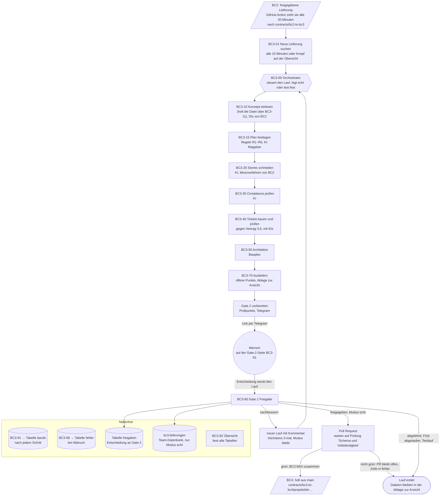

# Ablauf des BC3-Slicers

Von der Lieferung von BC2 bis zur Übergabe an BC4. Stand 18.11.2026 (vorher 23.10.2026, Änderungen am Ende).

## Kurz

- Ein Lauf hat neun Schritte: BC3-10, BC3-15, BC3-20, BC3-30, BC3-40, BC3-50, BC3-70, Gate 2, BC3-80.
- KI arbeitet nur in drei Schritten: BC3-15 (Ratgeber, ändert nichts), BC3-20 (Stories) und BC3-30 (Compliance). Alles andere sind feste Regeln.
- Ein Mensch entscheidet nur an Gate 2: freigeben, nachbessern oder ablehnen. Ohne Entscheidung endet der Lauf nach 7 Tagen mit `frist_abgelaufen`.
- „Nachbessern“ startet den Lauf mit demselben Konzept und dem Kommentar neu, höchstens dreimal. Ablehnen ist endgültig.
- Modus `echt` nur für echte Lieferungen von BC2. Testläufe (Übungsmandant, Simulation, Start von Hand) liefern nichts an BC4.
- Bei Freigabe im Modus `echt`: Pull Request nach `contracts/bc3-to-bc4/`, BC3 führt ihn erst zusammen, wenn die Prüfung „Schema und Vollständigkeit“ grün ist.
- Seit 18.11.2026 Vertrag BC3 → BC4 **3.6**: Die IDs von BC2 (Mandant, Paket, Priorisierung, Potenzial) laufen bis ins Ticket-Set mit. Erste Lieferung danach: `kp-06/del-kp-06-2026-11-18-201545` (UC1, PR #402).

## Bild

## Schritte

| Nr. | Schritt | Was reinkommt | Was rauskommt | KI | Wohin geschrieben |
|---|---|---|---|---|---|
| 0 | **BC3-01** Neue Lieferung suchen | Dateiliste `contracts/bc2-to-bc3/lieferungen/` auf `main`, `gate1.status`, bekannte Läufe | je neuem Konzept ein Start von BC3-00, nur freigegebene Potenziale | nein | – |
| – | **BC3-00** Orchestrator | Pfad der Konzeptdatei | legt den Liefermodus fest (siehe „Echt oder Test“), ruft die Schritte nacheinander auf, hält an Gate 2 an, startet bei „nachbessern“ neu, schreibt den Abschlussbericht | nein | über BC3-91 in `laeufe` |
| 1 | **BC3-10** Konzept einlesen (mit BC3-11) | Konzeptdatei und `prozesspriorisierung.json` aus GitHub | Potenziale mit Anforderungen (A), Akzeptanzkriterien (K), Vorgaben (V); IDs von BC2 (Mandant, Paket, Priorisierung, Anfrage, Konzept); Eingangsprüfung | nein | – |
| 2 | **BC3-15** Plan festlegen | Potenziale, Anbindungen, Herkunft der Zahlen | Plan: welche Stufe in welchem Modus (R1–R6); Hochrisiko-Regel für alle acht Bereiche aus Anhang III; Hinweise des Ratgebers | nur Ratgeber (`mistral-medium-3-5`), ändert den Plan nicht | – |
| 3 | **BC3-20** Stories schneiden | Potenziale | je Potenzial ein Epic mit Stories und Akzeptanzkriterien, Abdeckung von A, K, V. Messverfahren: wörtlich von BC2, wenn das Kriterium zu einem K passt; sonst „offen: von BC3 abgeleitet, BC2 nennt dafür kein Messverfahren“. BC3 erfindet keine Messverfahren | ja (`mistral-large-2512`, Temperatur 0, Seed 42) | – |
| 4 | **BC3-30** Compliance prüfen | Epics, Datenarten, Tragweite | Ampel, Risikoklasse nach KI-VO, Pflichten mit Adressat, Zusatz-Stories, Zuordnung zu vorhandenen Stories; meldet Pflichten mit Artikeln, die nur für Hochrisiko gelten (`artikel_nur_hochrisiko`), und vermerkt sie bei Klasse unter `high` als `freiwillig` mit `grundlage_hinweis`; beim Neustart bekommt die KI den Kommentar von Gate 2 | ja (`mistral-large-2512`, Temperatur 0, Seed 42) | – |
| 5 | **BC3-40** Tickets bauen und prüfen | Epics, Compliance-Befund, IDs | `ticket_set.json` mit IDs in `konzept_ref` und `potenzial_id` je Epic, `compliance-audit.json`; geprüft wie Schema 3.6; bricht ab, wenn etwas nicht passt | nein | – |
| 6 | **BC3-50** Architektur | Tickets | `architecture.md` (Mermaid), `blueprint.json` mit menschlichen Entscheidungspunkten; API-Teil abgeschaltet | nein | – |
| 7 | **BC3-70** Ausliefern | alle Dateien des Laufs | `offene-punkte.json` (was offen ist und für wen, bleibt bei BC3), Dateien zur Ansicht, je Lieferung ein Ordner | nein | Ablage zur Ansicht |
| 8 | **Gate 2** (BC3-00, BC3-81) | Umschlag des Laufs | fünf maschinelle Prüfpunkte, drei Akzeptanzkriterien zur Stichprobe, Telegram mit Link; die Seite zeigt Eingang, Schritte, Ergebnis, Ausgang | nein | `gate2_ansicht` |
| 9 | **BC3-80** Gate 2 Freigabe | Entscheidung, Begründung | Entscheidung festgehalten. Bei Freigabe im Modus `echt`: Pull Request mit vier Dateien nach `contracts/bc3-to-bc4/<projekt>/<lieferung>/`, bis 5 × 30 Sekunden auf die Prüfung „Schema und Vollständigkeit“ warten, nur bei grün zusammenführen, sonst bleibt der Pull Request offen und eine Zeile kommt in `fehler`. Danach Zeile in `bc3.lieferungen` | nein | `freigaben`, GitHub, Team-Datenbank |

## Echt oder Test

BC3-00 legt zu Beginn fest, ob ein Lauf `echt` oder `test` ist:

| Fall | Modus |
|---|---|
| Lieferung von BC2 unter `contracts/bc2-to-bc3/lieferungen/`, gestartet von BC3-01 | `echt` |
| Ordner beginnt mit `simulation-` oder `übungsmandant-` (auch `uebungsmandant-`) | immer `test` |
| Start von Hand im Editor ohne Angabe | `test` |
| Start von Hand mit `liefermodus: echt` | `echt` (außer Simulation, Übungsmandant) |
| Neustart nach „nachbessern“ | wie der Lauf davor |

Nur Läufe im Modus `echt` erzeugen nach der Freigabe einen Pull Request und eine Zeile in `bc3.lieferungen`.

**Ordner in `contracts/bc3-to-bc4/<projekt>/`** (Übersicht im [README dort](../contracts/bc3-to-bc4/README.md)):

| Präfix | Bedeutung |
|---|---|
| `del-` | gültige Lieferung aus einem echten Lauf |
| `test-del-` | Testlauf mit Übungsmandant oder Simulation, nur zum Ausprobieren |
| `veraltet-del-` | echter Lauf, aber alter Stand, nicht mehr maßgeblich |

Die Präfixe `test-` und `veraltet-` werden bisher von Hand vergeben (18.11.2026). BC3-80 legt jede Lieferung als `del-` an.

## IDs durch die Kette

Damit sich ein Ergebnis von BC4 der Vorgabe von BC2 zuordnen lässt (Soll-Ist-Vergleich), reicht BC3 die IDs von BC2 unverändert durch:

| ID | Kommt von | Steht im Ticket-Set | Steht in `bc3.lieferungen` |
|---|---|---|---|
| Mandant `company_id` | BC2, Konzept | `konzept_ref.company_id` | `company_id` |
| Paket `paket_id` | BC2, Priorisierung | `konzept_ref.paket_id` | `paket_id` |
| Priorisierung `priorisierung_id` | BC2, Priorisierung | `konzept_ref.priorisierung_id` | `priorisierung_id` |
| Anfrage `anfrage_id` | BC2, Priorisierung (wenn vorhanden) | `konzept_ref.anfrage_id` | `anfrage_id` |
| Konzept `konzept_id` | BC2, Konzept | `konzept_ref.konzept_id` | `konzept_id` |
| Kernprozess, Teilprozesse | BC0 über BC2 | `konzept_ref.kp_id`, `teilprozess_ids` | `process_id`, `sub_process_id` |
| Potenzial `potenzial_id` | BC2, je Potenzial | je Epic `potenzial_id` | `potenzial_ids` (alle) |

In `bc3.lieferungen` stehen außerdem `status` (`gueltig`, `test`, `veraltet`, wie die Ordnernamen) und Kopien von `ticket_set`, `compliance_audit` und `blueprint`. Je Paket und Kernprozess ist nur eine Zeile `gueltig`: Kommt eine neue gültige Lieferung, setzt BC3-80 die ältere auf `veraltet`.

## Was nebenher läuft

- **BC3-91 Laufprotokoll:** schreibt nach jedem Schritt den Stand in eine Zeile in `laeufe` (Status `laeuft`, `wartet_gate2`, `freigegeben`, `nachbessern`, `abgelehnt`, `abgebrochen`), mit Dauer und Kosten.
- **BC3-99 Fehlerprotokoll:** schreibt jeden Abbruch in `fehler`, getrennt nach gewollter Prüfung (`pruefung`) und Defekt (`fehler`).
- **BC3-82 Übersicht:** liest `laeufe`, `freigaben`, `fehler` und die Lieferungen von BC2; Knopf „Jetzt prüfen“ startet BC3-01. Testläufe sind eingeklappt.
- **BC3-83 Prüfstand:** prüft monatlich die Risikoklasse von BC3-30 an 16 festen Fällen, siehe [nachweis-pruefstand-reproduzierbarkeit.md](nachweis-pruefstand-reproduzierbarkeit.md).

Laufprotokoll, Entscheidungen und Fehler liegen in einem eigenen Supabase-Projekt von BC3 (EU). In die Team-Datenbank schreibt BC3 nur Lieferungen im Modus `echt` (`bc3.lieferungen`).

## Wenn etwas schiefgeht

- **Ein Schritt scheitert:** BC3-00 prüft, ob ein zweiter Versuch sinnvoll ist (R6), ordnet den Fehler ein (etwa „Dienst nicht erreichbar“) und schließt den Lauf mit Status `abgebrochen`. Der Fehler steht in `fehler`, der Lauf auf der Übersicht.
- **Die Prüfung im Repo ist nicht grün:** Der Pull Request bleibt offen, eine Zeile kommt in `fehler`. Von Hand nachsehen und zusammenführen oder schließen.

## Was dieser Ablauf nicht abdeckt

- **Rückweg zu BC2:** „Nachbessern“ startet BC3 neu, erreicht BC2 aber nicht. Fehlende Messverfahren sind im Ticket-Set als „offen“ markiert und stehen in `offene-punkte.json`.
- **ID je Akzeptanzkriterium:** gibt es nicht, BC2 liefert keine. Nachverfolgen lässt sich die Kette bis zum Epic.
- **`anfrage_id`:** bleibt leer, wenn BC2 sie nicht mitliefert (so bei UC1).
- **Kommentar an Gate 2:** Er geht beim Neustart an BC3-20 und seit 18.11.2026 auch an BC3-30. Ob die KI ihn umsetzt, ist nicht garantiert; nach dem Neustart prüft ihn wieder ein Mensch an Gate 2. Artikel, die nur für Hochrisiko gelten, vermerkt die Kette bei begrenztem oder minimalem Risiko selbst als freiwillig.
- **Rückkanal von BC4:** BC3 erfährt nicht, was BC4 gebaut hat.
- **Was BC4 daraus macht:** endet an der Übergabe in `contracts/bc3-to-bc4/`.

## Änderungen seit 23.10.2026

- **25.10.** `paket_id` und `anfrage_id` von BC2 bis in `bc3.lieferungen` und in den Text des Pull Requests.
- **11.11.** `bc3.lieferungen` bekommt Kopien von `ticket_set`, `compliance_audit` und `blueprint` (Akzeptanzkriterien für Testfälle bei BC4).
- **11.11.** Rückweg an Gate 2: „nachbessern“ startet einen neuen Lauf mit Kommentar, höchstens dreimal.
- **13.11.** BC2 liefert automatisch: eine GitHub Action holt freigegebene Lieferungen alle 30 Minuten ins Repo.
- **18.11.** Vertrag BC3 → BC4 3.6 (PR #399): IDs von BC2 im Ticket-Set, `potenzial_id` je Epic, `value_quelle` darf `keine` sein.
- **18.11.** Liefermodus: Simulation, Übungsmandant und Start von Hand sind `test`, der Neustart behält den Modus.
- **18.11.** BC3-80 führt erst nach grüner Prüfung „Schema und Vollständigkeit“ zusammen.
- **18.11.** BC3-20 übernimmt Messverfahren von BC2, wo es welche gibt.
- **18.11.** BC3-30 bekommt den Kommentar von Gate 2 (vorher nur BC3-20) und vermerkt Pflichten mit Hochrisiko-Artikeln bei Klasse unter `high` als freiwillig.
- **18.11.** Lieferordner gekennzeichnet: `del-`, `test-del-`, `veraltet-del-` (PR #401).
- **18.11.** `bc3.lieferungen` um `priorisierung_id`, `konzept_id`, `potenzial_ids` und `status` erweitert, BC3-80 schreibt sie.
- **18.11.** Erste Lieferung nach 3.6: `del-kp-06-2026-11-18-201545` (UC1, PR #402).
