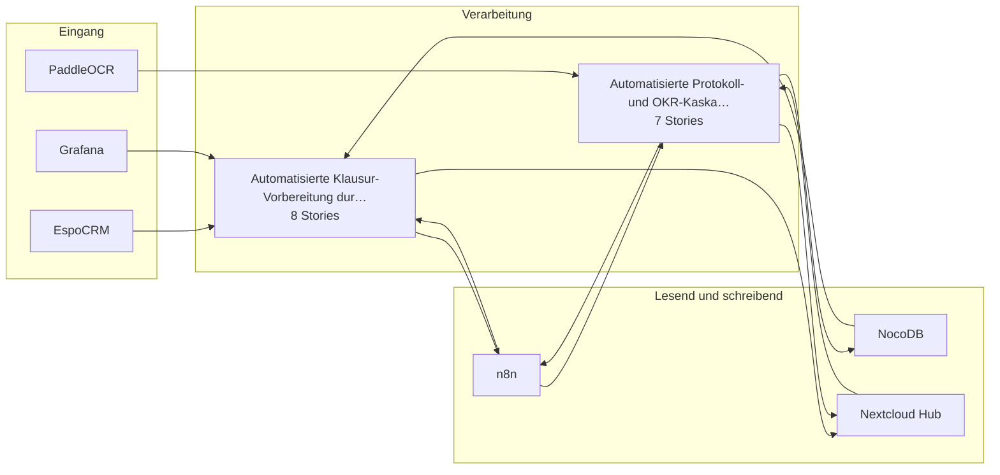

# Bauplan — kp-01

**Lieferung:** `del-kp-01-2026-11-13-130559`  
**Konzept:** `51a80db2-799c-405e-b45f-38862830f59c`  
**Erzeugt am:** 2026-11-13 durch den BC3-Slicer

> Automatisch erzeugt aus dem Ticket-Set. Nicht von Hand ändern —
> Änderungen gehen beim nächsten Lauf verloren.

## Überblick

Die Epics stehen in der Reihenfolge der Umsetzungsempfehlung von BC2. Das ist kein Ablauf.

## Komponenten

| Komponente | Rolle | Anbindung | Use Case |
|---|---|---|---|
| EspoCRM | Quelle | API | Automatisierte Klausur-Vorbereitu… |
| Grafana | Quelle | API | Automatisierte Klausur-Vorbereitu… |
| PaddleOCR | Quelle | API | Automatisierte Protokoll- und OKR… |
| NocoDB | Quelle, Ziel | API | Automatisierte Klausur-Vorbereitu…, Automatisierte Protokoll- und OKR… |
| n8n | Quelle+Ziel | API | Automatisierte Klausur-Vorbereitu…, Automatisierte Protokoll- und OKR… |
| Nextcloud Hub | Ziel, Quelle+Ziel | API | Automatisierte Klausur-Vorbereitu…, Automatisierte Protokoll- und OKR… |

## Tech-Stack laut Konzept (BC2)

- n8n (self-hosted, Hetzner) — Workflow-Orchestrierung und Datenabruf
- Ollama mit Mistral oder Llama — primäres LLM für Textsynthese (EU, OSS, kein externes API erforderlich)
- Anthropic Claude API (EU-Region, AVV) — Fallback-LLM bei höherer Synthesekomplexität
- Nextcloud Hub (self-hosted, Hetzner) — Ablage und Freigabe des generierten Drafts
- GitLab self-hosted — Versionierung der Prompt-Templates und Workflow-Konfiguration
- PostgreSQL 16 — optionale Persistenz von Workflow-Läufen und Snapshot-Daten
- n8n (self-hosted, Hetzner) — Workflow-Orchestrierung und Input-Routing
- Ollama mit Mistral oder Llama — primäres LLM für Protokoll-Synthese und OKR-Strukturierung (EU, OSS)
- Anthropic Claude API (EU-Region, AVV) — Fallback-LLM bei hoher Eingabe-Komplexität
- PaddleOCR (self-hosted) — OCR für Whiteboard-Fotos und gescannte Unterlagen
- Nextcloud Hub (self-hosted, Hetzner) — Ablage von Protokoll und OKR-Fallback-Dateien
- NocoDB (self-hosted, IONOS) — strukturiertes Logging der Workflow-Läufe
- GitLab self-hosted — Versionierung von Prompt-Templates und OKR-Schema

## Epics und Stories

### Automatisierte Klausur-Vorbereitung durch Lagedaten-Aggregation

`ep-703c-a5c0-a016-79366fe7cea8`  
**Ziel:** Die Geschäftsführung erhält termingerecht einen vollständigen, strukturierten Klausur-Vorbereitungsdraft aus automatisiert aggregierten Lagedaten und einem Agenda-Entwurf.  
**Kategorien:** it:backend, it:integration, it:ai-pipeline

| Story | Titel | Akzeptanzkriterien |
|---|---|---|
| 1 | Terminbasierte Workflow-Auslösung einrichten | 1 |
| 2 | Daten aus Quellsystemen abrufen und normalisieren | 2 |
| 3 | Transparente Datenherkunft im Draft ausweisen | 1 |
| 4 | Strukturierten Draft mit Lagebild und Agenda-Entwurf erstel… | 2 |
| 5 | Personenbezogene Daten datenschutzkonform filtern | 1 |
| 6 | Draft in Nextcloud Hub ablegen und Freigabeprozess ermöglic… | 2 |
| 7 | Ad-hoc-Klausuren mit vorläufigem Lagebild unterstützen | 1 |
| 8 | Kennzeichnung LLM-generierter Inhalte im Draft | 1 |

### Automatisierte Protokoll- und OKR-Kaskaden-Ableitung nach der Strategie-Klausur

`ep-592d-60c5-c0cd-4eab59bdbf35`  
**Ziel:** Ein KI-gestützter Workflow ersetzt die manuelle Protokollerstellung und OKR-Kaskaden-Ableitung, um unmittelbar nach der Klausur einen freigebbaren Protokollentwurf und OKR-Vorschläge im OKR-Tooling bereitzustellen.  
**Kategorien:** it:backend, it:integration, it:ai-pipeline

| Story | Titel | Akzeptanzkriterien |
|---|---|---|
| 1 | Eingabeformat des Klausur-Inputs erkennen und Routing steue… | 2 |
| 2 | Extraktion unstrukturierter Klausur-Inputs durchführen | 2 |
| 3 | Strukturierten Protokollentwurf aus Klausur-Inputs generier… | 3 |
| 4 | OKR-Kaskade aus Protokoll ableiten und im OKR-Tooling vorei… | 3 |
| 5 | Protokollentwurf und OKR-Vorschläge zeitnah bereitstellen | 2 |
| 6 | Workflow-Lauf in NocoDB protokollieren | 1 |
| 7 | Kennzeichnung LLM-generierter Protokoll- und OKR-Inhalte | 1 |

---

2 Epics · 15 Stories · 6 Komponenten
