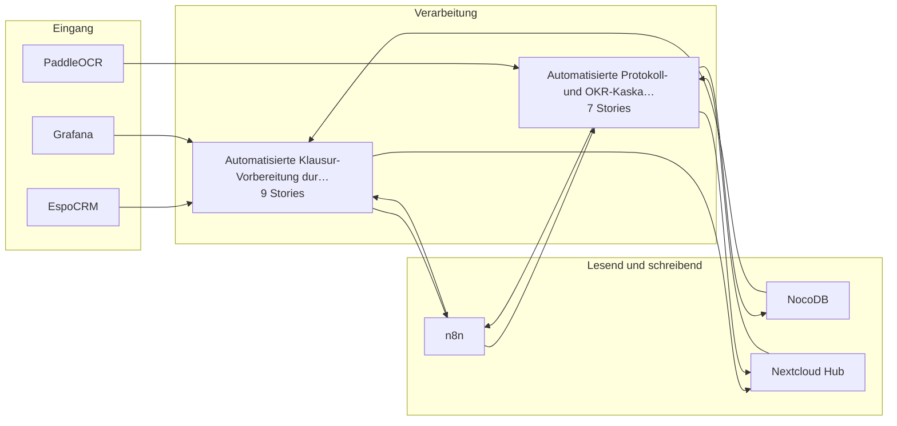

# Bauplan — kp-01

**Lieferung:** `del-kp-01-2026-11-18-183750`  
**Konzept:** `51a80db2-799c-405e-b45f-38862830f59c`  
**Erzeugt am:** 2026-11-18 durch den BC3-Slicer

> Automatisch erzeugt aus dem Ticket-Set. Nicht von Hand ändern —
> Änderungen gehen beim nächsten Lauf verloren.

## Überblick

Die Epics stehen in der Reihenfolge der Umsetzungsempfehlung von BC2. Das ist kein Ablauf.

## Komponenten

| Komponente | Rolle | Anbindung | Use Case |
|---|---|---|---|
| EspoCRM | Quelle | API | Automatisierte Klausur-Vorbereitu… |
| Grafana | Quelle | API | Automatisierte Klausur-Vorbereitu… |
| PaddleOCR | Quelle | API | Automatisierte Protokoll- und OKR… |
| NocoDB | Quelle, Ziel | API | Automatisierte Klausur-Vorbereitu…, Automatisierte Protokoll- und OKR… |
| n8n | Quelle+Ziel | API | Automatisierte Klausur-Vorbereitu…, Automatisierte Protokoll- und OKR… |
| Nextcloud Hub | Ziel, Quelle+Ziel | API | Automatisierte Klausur-Vorbereitu…, Automatisierte Protokoll- und OKR… |

## Tech-Stack laut Konzept (BC2)

- n8n (self-hosted, Hetzner) — Workflow-Orchestrierung und Datenabruf
- Ollama mit Mistral oder Llama — primäres LLM für Textsynthese (EU, OSS, kein externes API erforderlich)
- Anthropic Claude API (EU-Region, AVV) — Fallback-LLM bei höherer Synthesekomplexität
- Nextcloud Hub (self-hosted, Hetzner) — Ablage und Freigabe des generierten Drafts
- GitLab self-hosted — Versionierung der Prompt-Templates und Workflow-Konfiguration
- PostgreSQL 16 — optionale Persistenz von Workflow-Läufen und Snapshot-Daten
- n8n (self-hosted, Hetzner) — Workflow-Orchestrierung und Input-Routing
- Ollama mit Mistral oder Llama — primäres LLM für Protokoll-Synthese und OKR-Strukturierung (EU, OSS)
- Anthropic Claude API (EU-Region, AVV) — Fallback-LLM bei hoher Eingabe-Komplexität
- PaddleOCR (self-hosted) — OCR für Whiteboard-Fotos und gescannte Unterlagen
- Nextcloud Hub (self-hosted, Hetzner) — Ablage von Protokoll und OKR-Fallback-Dateien
- NocoDB (self-hosted, IONOS) — strukturiertes Logging der Workflow-Läufe
- GitLab self-hosted — Versionierung von Prompt-Templates und OKR-Schema

## Epics und Stories

### Automatisierte Klausur-Vorbereitung durch Lagedaten-Aggregation

`ep-703c-a5c0-a016-79366fe7cea8`  
**Ziel:** Die Geschäftsführung erhält termingerecht einen vollständigen, automatisiert erstellten Klausur-Vorbereitungsdraft mit Lagebild und Agenda-Entwurf, um manuelle Routinearbeit zu reduzieren.  
**Kategorien:** it:backend, it:integration, it:ai-pipeline

| Story | Titel | Akzeptanzkriterien |
|---|---|---|
| 1 | Termingesteuerte Workflow-Auslösung für Klausur-Vorbereitung | 2 |
| 2 | Datenabruf aus EspoCRM, Grafana und NocoDB | 3 |
| 3 | Transparente Kennzeichnung der Datenquellen und Abrufzeitpu… | 1 |
| 4 | Verarbeitung unstrukturierter KB-Input-Daten | 1 |
| 5 | Textsynthese des Lagebilds und Agenda-Entwurfs durch LLM | 2 |
| 6 | Ablage des Drafts in Nextcloud Hub und Freigabeprozess | 2 |
| 7 | Kennzeichnung vorläufiger Lagebilder bei Ad-hoc-Klausuren | 1 |
| 8 | Kennzeichnung LLM-generierter Inhalte im Lagebild und Agend… | 1 |
| 9 | Pseudonymisierung von Zugangsdaten vor LLM-Verarbeitung | 1 |

### Automatisierte Protokoll- und OKR-Kaskaden-Ableitung nach der Strategie-Klausur

`ep-592d-60c5-c0cd-4eab59bdbf35`  
**Ziel:** Ein KI-gestützter Workflow erzeugt unmittelbar nach der Klausur einen freigebbaren Protokollentwurf und trägt OKR-Vorschläge ins OKR-Tooling ein, um die Nachbereitungszeit von mehreren Tagen auf nahezu sofortige Verfügbarkeit zu reduzieren.  
**Kategorien:** it:backend, it:integration, it:ai-pipeline

| Story | Titel | Akzeptanzkriterien |
|---|---|---|
| 1 | Eingabeformat des Klausur-Inputs erkennen und Extraktionssc… | 2 |
| 2 | Strukturierten Protokollentwurf aus Klausur-Notizen generie… | 3 |
| 3 | OKR-Kaskade aus Protokoll ableiten und ins OKR-Tooling eint… | 3 |
| 4 | Protokollentwurf und OKR-Vorschläge für Freigabe bereitstel… | 2 |
| 5 | Protokollentwurf aus Audio-Aufzeichnungen kennzeichnen und … | 1 |
| 6 | Kennzeichnung LLM-generierter Protokollentwürfe und OKR-Vor… | 1 |
| 7 | Hinweis auf KI-Interaktion bei Protokollentwurf und OKR-Vor… | 1 |

---

2 Epics · 16 Stories · 6 Komponenten
