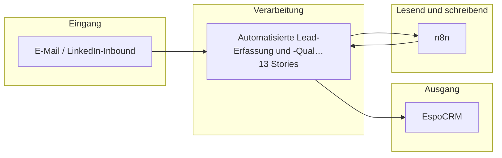

# Bauplan — kp-02

**Lieferung:** `del-kp-02-2026-10-23-051620`  
**Konzept:** `00000000-0000-4000-8000-000000000002`  
**Erzeugt am:** 2026-10-23 durch den BC3-Slicer

> Automatisch erzeugt aus dem Ticket-Set. Nicht von Hand ändern —
> Änderungen gehen beim nächsten Lauf verloren.

## Überblick

Die Epics stehen in der Reihenfolge der Umsetzungsempfehlung von BC2. Das ist kein Ablauf.

## Komponenten

| Komponente | Rolle | Anbindung | Use Case |
|---|---|---|---|
| E-Mail / LinkedIn-Inbound | Quelle | Email | VORLAEUFIG Lead-Erfassung und -Qu… |
| n8n | Quelle+Ziel | API | VORLAEUFIG Lead-Erfassung und -Qu… |
| EspoCRM | Ziel | API | VORLAEUFIG Lead-Erfassung und -Qu… |

## Tech-Stack laut Konzept (BC2)

- n8n
- EspoCRM (API)
- Claude (Sonnet 4.6)
- PostgreSQL

## Epics und Stories

### Automatisierte Lead-Erfassung und -Qualifizierung aus E-Mail- und LinkedIn-Anfragen ins CRM

`ep-9491-9a1f-14e8-fbb799d51e6b`  
**Ziel:** Eingehende Anfragen ohne manuelle Datenerfassung als qualifizierte Leads im CRM erfassen und den Vertrieb nur bei unklaren Fällen einbinden.  
**Kategorien:** it:backend, it:integration, it:ai-pipeline

| Story | Titel | Akzeptanzkriterien |
|---|---|---|
| 1 | Posteingang und LinkedIn-Inbound für Lead-Erfassung abgreif… | 2 |
| 2 | Strukturierte Lead-Daten aus Anfragen extrahieren | 2 |
| 3 | Lead-Daten über EspoCRM-API anlegen | 2 |
| 4 | Teilautomatisches Lead-Scoring anstoßen | 1 |
| 5 | Konfidenzschwelle für Lead-Erfassung prüfen | 2 |
| 6 | DSGVO-konforme Verarbeitung von Kontaktdaten sicherstellen | 2 |
| 7 | Abgrenzung der LLM-Felder prüfen | 1 |
| 8 | Transparenzhinweis bei erster Kontaktaufnahme mit Leads ein… | 1 |
| 9 | Pseudonymisierung von Kontaktdaten vor LLM-Verarbeitung | 1 |
| 10 | Menschliche Freigabe für Lead-Scoring und Lead-Erfassung im… | 2 |
| 11 | Ausgabe übersteuern oder verwerfen (Art. 14 KI-VO) | 1 |
| 12 | Betrieb anhalten (Art. 14 KI-VO) | 1 |
| 13 | Aufsichtsentscheidungen protokollieren (Art. 12 und 14 KI-V… | 1 |

---

1 Epics · 13 Stories · 3 Komponenten
