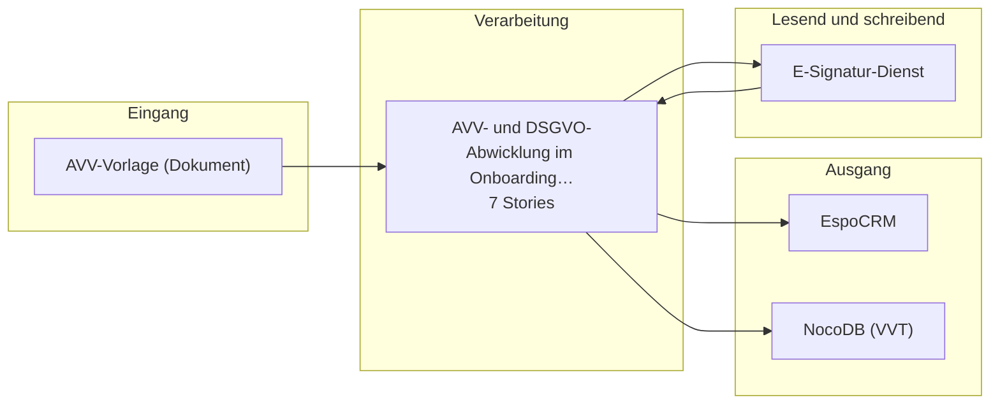

# Bauplan — kp-03

**Lieferung:** `del-kp-03-2026-10-23-051601`  
**Konzept:** `00000000-0000-4000-8000-000000000003`  
**Erzeugt am:** 2026-10-23 durch den BC3-Slicer

> Automatisch erzeugt aus dem Ticket-Set. Nicht von Hand ändern —
> Änderungen gehen beim nächsten Lauf verloren.

## Überblick

Die Epics stehen in der Reihenfolge der Umsetzungsempfehlung von BC2. Das ist kein Ablauf.

## Komponenten

| Komponente | Rolle | Anbindung | Use Case |
|---|---|---|---|
| AVV-Vorlage (Dokument) | Quelle | Datei | VORLAEUFIG AVV- und DSGVO-Abwickl… |
| E-Signatur-Dienst | Quelle+Ziel | API | VORLAEUFIG AVV- und DSGVO-Abwickl… |
| EspoCRM | Ziel | API | VORLAEUFIG AVV- und DSGVO-Abwickl… |
| NocoDB (VVT) | Ziel | API | VORLAEUFIG AVV- und DSGVO-Abwickl… |

## Tech-Stack laut Konzept (BC2)

- E-Signatur-Dienst
- n8n
- EspoCRM (API)
- NocoDB

## Epics und Stories

### AVV- und DSGVO-Abwicklung im Onboarding medienbruchfrei digitalisieren

`ep-c0dc-7dbb-722e-31673d2f4c7b`  
**Ziel:** Die AVV-Vorlage wird aus CRM-Daten vorbefüllt, digital signiert und der VVT-Eintrag automatisch in NocoDB erzeugt, um den Medienbruch bei der Unterzeichnung zu eliminieren.  
**Kategorien:** it:backend, it:integration

| Story | Titel | Akzeptanzkriterien |
|---|---|---|
| 1 | AVV-Vorlage aus CRM-Daten vorbefüllen | 2 |
| 2 | E-Signatur-Prozess für AVV-Vorlage einrichten | 2 |
| 3 | Signierte AVV in EspoCRM speichern | 1 |
| 4 | VVT-Eintrag in NocoDB automatisch erstellen | 2 |
| 5 | Sonderfall Papierunterzeichnung dokumentieren | 1 |
| 6 | Datenminimierung in der AVV-Vorlage sicherstellen | 1 |
| 7 | Transparenzhinweis bei der E-Signatur einbinden | 1 |

---

1 Epics · 7 Stories · 4 Komponenten
