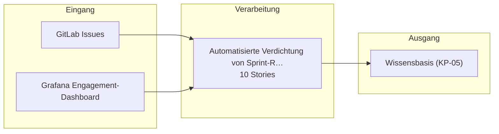

# Bauplan — kp-04

**Lieferung:** `del-kp-04-2026-10-23-051616`  
**Konzept:** `00000000-0000-4000-8000-000000000004`  
**Erzeugt am:** 2026-10-23 durch den BC3-Slicer

> Automatisch erzeugt aus dem Ticket-Set. Nicht von Hand ändern —
> Änderungen gehen beim nächsten Lauf verloren.

## Überblick

Die Epics stehen in der Reihenfolge der Umsetzungsempfehlung von BC2. Das ist kein Ablauf.

## Komponenten

| Komponente | Rolle | Anbindung | Use Case |
|---|---|---|---|
| GitLab Issues | Quelle | API | VORLAEUFIG Sprint-Retrospektive u… |
| Grafana Engagement-Dashboard | Quelle | API | VORLAEUFIG Sprint-Retrospektive u… |
| Wissensbasis (KP-05) | Ziel | API | VORLAEUFIG Sprint-Retrospektive u… |

## Tech-Stack laut Konzept (BC2)

- GitLab API
- Grafana API
- Claude (Sonnet 4.6)
- n8n

## Epics und Stories

### Automatisierte Verdichtung von Sprint-Retrospektiven und Lessons Learned

`ep-83df-c053-d143-3fb7eb291e6f`  
**Ziel:** Sprint-Daten aus GitLab und Grafana werden automatisiert zu einem Retrospektiven-Entwurf verdichtet und Lessons Learned strukturiert in die Wissensbasis überführt.  
**Kategorien:** it:backend, it:integration, it:ai-pipeline

| Story | Titel | Akzeptanzkriterien |
|---|---|---|
| 1 | Sprint-Daten aus GitLab und Grafana abrufen | 2 |
| 2 | Daten für Retrospektiven-Entwurf verdichten | 2 |
| 3 | Action-Items an KP-09 übermitteln | 1 |
| 4 | Lessons Learned in Wissensbasis (KP-05) speichern | 2 |
| 5 | API-Zugänge und Zielstruktur prüfen | 1 |
| 6 | Menschliche Freigabe des Retrospektiven-Entwurfs | 2 |
| 7 | Pseudonymisierung personenbezogener Daten vor der Verarbeit… | 2 |
| 8 | Protokollierung der KI-generierten Inhalte und Entscheidung… | 2 |
| 9 | Ausgabe übersteuern oder verwerfen (Art. 14 KI-VO) | 1 |
| 10 | Betrieb anhalten (Art. 14 KI-VO) | 1 |

---

1 Epics · 10 Stories · 3 Komponenten
