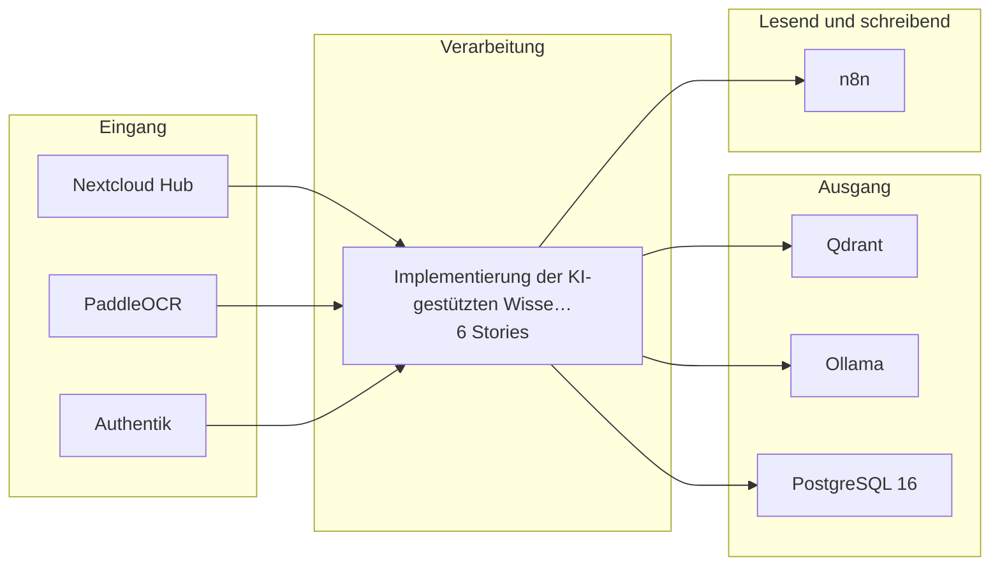

# Bauplan — kp-05

**Lieferung:** `del-kp-05-2026-10-11-184827`  
**Konzept:** `5d82f848-fdbc-40a9-9169-c03c0893b077`  
**Erzeugt am:** 2026-10-11 durch den BC3-Slicer

> Automatisch erzeugt aus dem Ticket-Set. Nicht von Hand ändern —
> Änderungen gehen beim nächsten Lauf verloren.

## Überblick

## Komponenten

| Komponente | Rolle | Anbindung | Use Case |
|---|---|---|---|
| Nextcloud Hub | Quelle | API | KI-gestützte Wissenssuche im Goog… |
| PaddleOCR | Quelle | API | KI-gestützte Wissenssuche im Goog… |
| Authentik | Quelle | API | KI-gestützte Wissenssuche im Goog… |
| n8n | Quelle+Ziel | API | KI-gestützte Wissenssuche im Goog… |
| Qdrant | Ziel | API | KI-gestützte Wissenssuche im Goog… |
| Ollama | Ziel | API | KI-gestützte Wissenssuche im Goog… |
| PostgreSQL 16 | Ziel | DB | KI-gestützte Wissenssuche im Goog… |

## Empfohlener Stack

- Qdrant (self-hosted, Hetzner) — Vector-DB für semantische Indizierung und gefilterte Abfragen
- Ollama mit Mistral oder Qwen — lokales LLM für Embedding-Generierung und Antwortvorschläge (EU, OSS, kein Datenabfluss)
- PaddleOCR — Texterkennung für nicht-native Dokumente
- n8n (self-hosted, Hetzner) — Orchestrierung der Indizierungspipeline, Webhook-Anbindung und Scheduler
- PostgreSQL 16 — persistente Ablage von Chunk-Metadaten, Quellenverweisen und Anfrage-Protokollen
- Authentik (self-hosted, IONOS) — Identitätsprüfung und Berechtigungsgruppen für die Zugriffsrechtespiegelung
- Nextcloud Hub (self-hosted, Hetzner) — primäre Dokumentenquelle; API-Zugriff auf Ordnerstruktur und Dateimetadaten
- Anthropic Claude API (EU-Region, nur mit gültigem AVV) — optionaler Fallback für komplexe Antwortgenerierung, wenn lokal betriebene Modelle dokumentiert nicht ausreichen

## Epics und Stories

### Implementierung der KI-gestützten Wissenssuche im Google-Drive-Bestand

`ep-b460-4f9d-bb2b-f789f03f5de5`  
**Ziel:** Automatisierung der Wissenssuche mit strukturierten Antworten und Quellenverweisen.  
**Kategorien:** it:backend, it:integration

| Story | Titel | Akzeptanzkriterien |
|---|---|---|
| 1 | Anbindung an Google Drive und Datenzugriff | 1 |
| 2 | Vektorisierung und Indizierung von Dokumenten | 1 |
| 3 | Benutzeranfrage und Antwortgenerierung | 2 |
| 4 | Zugriffsrechtespiegelung | 1 |
| 5 | Qualitätskontrolle der Antwortvorschläge | 1 |
| 6 | Menschliche Prüfung der Antwortvorschläge | 1 |

---

1 Epics · 6 Stories · 7 Komponenten
