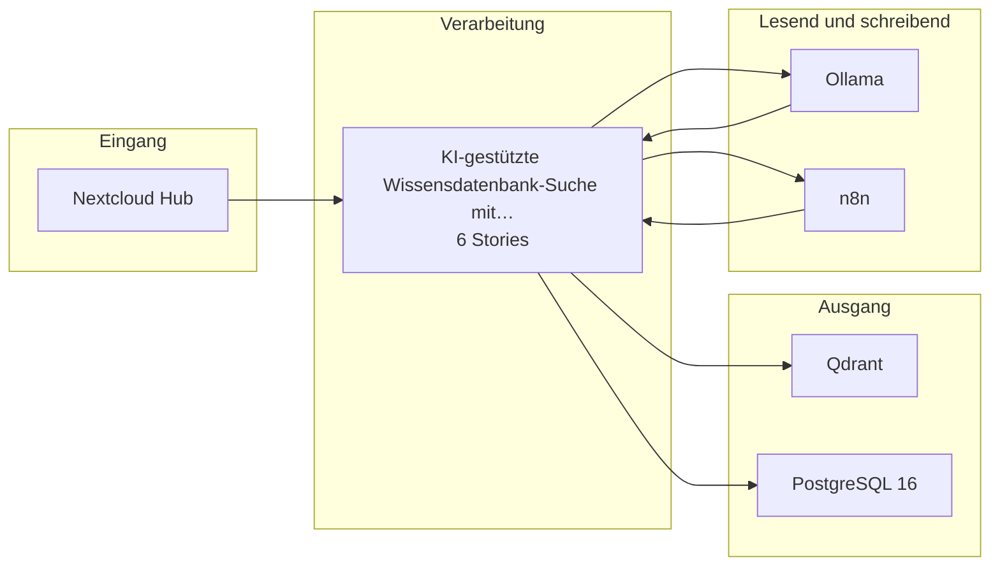

# Bauplan — kp-05

**Lieferung:** `del-kp-05-2026-10-23-051629`  
**Konzept:** `29391ca4-e90e-4db3-a15b-7f55498cfa2f`  
**Erzeugt am:** 2026-10-23 durch den BC3-Slicer

> Automatisch erzeugt aus dem Ticket-Set. Nicht von Hand ändern —
> Änderungen gehen beim nächsten Lauf verloren.

## Überblick

Die Epics stehen in der Reihenfolge der Umsetzungsempfehlung von BC2. Das ist kein Ablauf.

## Komponenten

| Komponente | Rolle | Anbindung | Use Case |
|---|---|---|---|
| Nextcloud Hub | Quelle | API | KI-gestützte Wissensdatenbank-Suc… |
| Ollama | Quelle+Ziel | API | KI-gestützte Wissensdatenbank-Suc… |
| n8n | Quelle+Ziel | API | KI-gestützte Wissensdatenbank-Suc… |
| Qdrant | Ziel | API | KI-gestützte Wissensdatenbank-Suc… |
| PostgreSQL 16 | Ziel | DB | KI-gestützte Wissensdatenbank-Suc… |

## Tech-Stack laut Konzept (BC2)

- n8n (self-hosted, Hetzner) — Orchestrierung der Indizierungs- und Abfragepipeline
- Ollama mit Mistral oder Llama — Embedding-Generierung und Antwort-Synthese (EU, OSS, Self-hosted)
- Qdrant (self-hosted) — Vector-Datenbank für semantische Suche
- PostgreSQL 16 — Metadaten-Speicher für Dokumentenindex, Zugriffsrechte und Qualitätsfeedback
- PaddleOCR oder Tesseract — OCR-Vorverarbeitung für gescannte Dokumente ohne Textschicht
- Nextcloud Hub — mittelfristig als Self-hosted-Ablösung des Google-Drive-Connectors für die Dokumentenquelle
- Anthropic Claude (EU-Region) oder Mistral La Plateforme — optionale Generierungsschicht für qualitätskritische Anfragen, nur wenn AVV vorliegt

## Epics und Stories

### KI-gestützte Wissensdatenbank-Suche mit RAG-Pipeline

`ep-35ec-f2fb-68d5-6d6dddfa6fa7`  
**Ziel:** Mitarbeitende erhalten auf Wissensfragen sofortige Antwortvorschläge mit verlinkten Quelldokumenten, um den manuellen Suchaufwand im Google-Drive-Bestand zu ersetzen.  
**Kategorien:** it:backend, it:integration, it:ai-pipeline

| Story | Titel | Akzeptanzkriterien |
|---|---|---|
| 1 | Initialer Aufbau des Dokumentenindex aus Google Drive | 4 |
| 2 | Inkrementelle Aktualisierung des Dokumentenindex | 4 |
| 3 | Semantische Suche und Antwortgenerierung mit Quellenangabe | 12 |
| 4 | Integration der Chat-Oberfläche für Nutzerinteraktion | 3 |
| 5 | Betrieb und Wartung der RAG-Pipeline auf Self-hosted-Infras… | 3 |
| 6 | Aktualisierte Dokumente in Antwortvorschlägen berücksichtig… | 3 |

---

1 Epics · 6 Stories · 5 Komponenten
