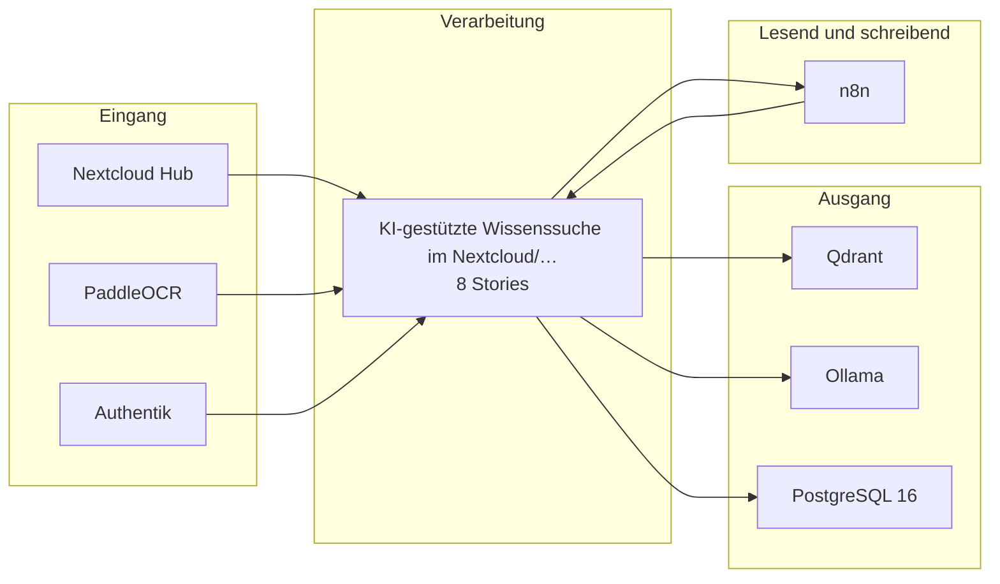

# Bauplan — kp-05

**Lieferung:** `del-kp-05-2026-10-26-185111`  
**Konzept:** `5d82f848-fdbc-40a9-9169-c03c0893b077`  
**Erzeugt am:** 2026-10-26 durch den BC3-Slicer

> Automatisch erzeugt aus dem Ticket-Set. Nicht von Hand ändern —
> Änderungen gehen beim nächsten Lauf verloren.

## Überblick

Die Epics stehen in der Reihenfolge der Umsetzungsempfehlung von BC2. Das ist kein Ablauf.

## Komponenten

| Komponente | Rolle | Anbindung | Use Case |
|---|---|---|---|
| Nextcloud Hub | Quelle | API | KI-gestützte Wissenssuche im Goog… |
| PaddleOCR | Quelle | API | KI-gestützte Wissenssuche im Goog… |
| Authentik | Quelle | API | KI-gestützte Wissenssuche im Goog… |
| n8n | Quelle+Ziel | API | KI-gestützte Wissenssuche im Goog… |
| Qdrant | Ziel | API | KI-gestützte Wissenssuche im Goog… |
| Ollama | Ziel | API | KI-gestützte Wissenssuche im Goog… |
| PostgreSQL 16 | Ziel | DB | KI-gestützte Wissenssuche im Goog… |

## Tech-Stack laut Konzept (BC2)

- Qdrant (self-hosted, Hetzner) — Vector-DB für semantische Indizierung und gefilterte Abfragen
- Ollama mit Mistral oder Qwen — lokales LLM für Embedding-Generierung und Antwortvorschläge (EU, OSS, kein Datenabfluss)
- PaddleOCR — Texterkennung für nicht-native Dokumente
- n8n (self-hosted, Hetzner) — Orchestrierung der Indizierungspipeline, Webhook-Anbindung und Scheduler
- PostgreSQL 16 — persistente Ablage von Chunk-Metadaten, Quellenverweisen und Anfrage-Protokollen
- Authentik (self-hosted, IONOS) — Identitätsprüfung und Berechtigungsgruppen für die Zugriffsrechtespiegelung
- Nextcloud Hub (self-hosted, Hetzner) — primäre Dokumentenquelle; API-Zugriff auf Ordnerstruktur und Dateimetadaten
- Anthropic Claude API (EU-Region, nur mit gültigem AVV) — optionaler Fallback für komplexe Antwortgenerierung, wenn lokal betriebene Modelle dokumentiert nicht ausreichen

## Epics und Stories

### KI-gestützte Wissenssuche im Nextcloud/Google-Drive-Bestand mit RAG-Schicht

`ep-35ec-f2fb-68d5-6d6dddfa6fa7`  
**Ziel:** Mitarbeitende erhalten innerhalb von Sekunden strukturierte Antwortvorschläge mit Quellenverweisen aus dem indizierten Drive-Bestand, um manuelle Suche und unstrukturierte Weitergabe zu ersetzen.  
**Kategorien:** it:backend, it:integration, it:ai-pipeline

| Story | Titel | Akzeptanzkriterien |
|---|---|---|
| 1 | Indizierungspipeline für Drive-Dokumente aufbauen | 5 |
| 2 | Zugriffsrechtespiegelung zwischen Drive und RAG-Schicht ums… | 3 |
| 3 | Semantische Suche und Antwortgenerierung implementieren | 9 |
| 4 | Quellenverweise und Metadaten korrekt ausgeben | 2 |
| 5 | Steuerung der indizierten Ordner durch Wissensverantwortlic… | 2 |
| 6 | Fallback auf Anthropic Claude API bei lokaler Modellinsuffi… | 2 |
| 7 | Protokollierung von Anfragen und Antworten umsetzen | 2 |
| 8 | Pseudonymisierung der E-Mail-Adressen vor Modellaufruf | 1 |

---

1 Epics · 8 Stories · 7 Komponenten
