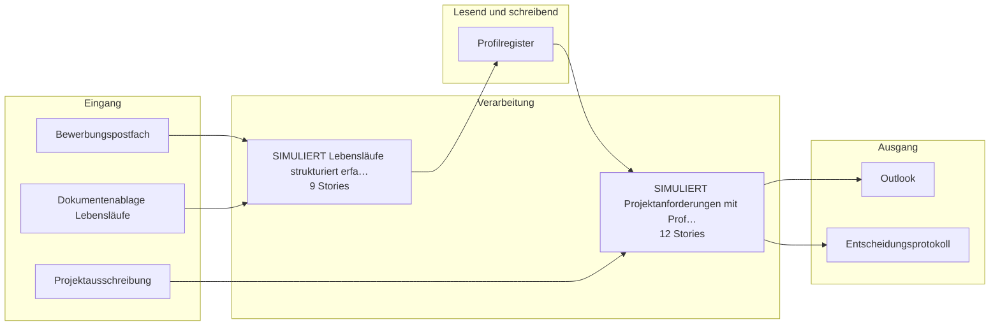

# Bauplan — kp-06

**Lieferung:** `del-kp-06-2026-10-23-051644`  
**Konzept:** `7780f764-245b-51f3-b5f7-791a2e283e94`  
**Erzeugt am:** 2026-10-23 durch den BC3-Slicer

> Automatisch erzeugt aus dem Ticket-Set. Nicht von Hand ändern —
> Änderungen gehen beim nächsten Lauf verloren.

## Überblick

Die Epics stehen in der Reihenfolge der Umsetzungsempfehlung von BC2. Das ist kein Ablauf.

## Komponenten

| Komponente | Rolle | Anbindung | Use Case |
|---|---|---|---|
| Bewerbungspostfach | Quelle | Email | SIMULIERT Lebensläufe strukturier… |
| Dokumentenablage Lebensläufe | Quelle | Datei | SIMULIERT Lebensläufe strukturier… |
| Projektausschreibung | Quelle | Datei | SIMULIERT Projektanforderung mit … |
| Profilregister | Ziel, Quelle | DB | SIMULIERT Lebensläufe strukturier…, SIMULIERT Projektanforderung mit … |
| Outlook | Ziel | Email | SIMULIERT Projektanforderung mit … |
| Entscheidungsprotokoll | Ziel | DB | SIMULIERT Projektanforderung mit … |

## Tech-Stack laut Konzept (BC2)

- n8n
- Mistral Large
- PostgreSQL
- OCR-Service

## Epics und Stories

### [SIMULIERT] Lebensläufe strukturiert erfassen und Kompetenzprofil aufbauen

`ep-a9be-718b-3d63-ca1b97086e3b`  
**Ziel:** Automatisierte Extraktion und strukturierte Speicherung von Lebenslaufdaten in ein einheitliches Kompetenzprofil mit Belegstellen und Markierung unsicherer Angaben.  
**Kategorien:** it:backend, it:integration, it:ai-pipeline

| Story | Titel | Akzeptanzkriterien |
|---|---|---|
| 1 | Dokumenteingang und Einwilligungsprüfung | 2 |
| 2 | Extraktion und Strukturierung der Lebenslaufdaten | 3 |
| 3 | Profilregister anlegen und Teilprozess-ID zuordnen | 1 |
| 4 | Auskunfts- und Korrekturprozess für betroffene Personen | 2 |
| 5 | Löschung von Profilen nach Aufbewahrungsfrist | 1 |
| 6 | Verhinderung von Bewertung und Rangfolge | 1 |
| 7 | Pseudonymisierung von Kontaktdaten vor der Verarbeitung | 2 |
| 8 | Protokollierung der Extraktion und Strukturierung von Leben… | 1 |
| 9 | Erläuterung der Funktionsweise des KI-Systems für Betroffene | 1 |

### [SIMULIERT] Projektanforderungen mit Profilen abgleichen und Vorschlagsliste automatisiert erzeugen

`ep-ced5-391a-9fc7-55ce432f85ce`  
**Ziel:** Automatisiertes Auffinden und Vorsortieren passender Profile für Projektausschreibungen, um die manuelle Sichtung zu ersetzen und eine begründete Vorschlagsliste binnen Minuten zu liefern.  
**Kategorien:** it:backend, it:integration, it:ai-pipeline

| Story | Titel | Akzeptanzkriterien |
|---|---|---|
| 1 | Anforderungen aus Projektausschreibung strukturiert erfassen | 1 |
| 2 | Profile mit Anforderungen abgleichen und Vorschlagsliste ge… | 4 |
| 3 | Vorschlagsliste als unverbindlichen Vorschlag kennzeichnen | 2 |
| 4 | Auswahlentscheidungen mit Begründung protokollieren | 1 |
| 5 | Betroffene über Verfahren und Datengrundlage informieren | 1 |
| 6 | Vorschlagsliste an Outlook versenden | 1 |
| 7 | Teilprozess-ID im Vorgang protokollieren | 1 |
| 8 | Ablehnung nur mit dokumentierter menschlicher Entscheidung … | 1 |
| 9 | Transparenzhinweis für betroffene Personen über den KI-Eins… | 1 |
| 10 | Menschliche Entscheidung bei Auswahl und Ablehnung erzwingen | 2 |
| 11 | Protokollierung der menschlichen Aufsichtsentscheidungen | 1 |
| 12 | Betrieb anhalten (Art. 14 KI-VO) | 1 |

---

2 Epics · 21 Stories · 6 Komponenten
