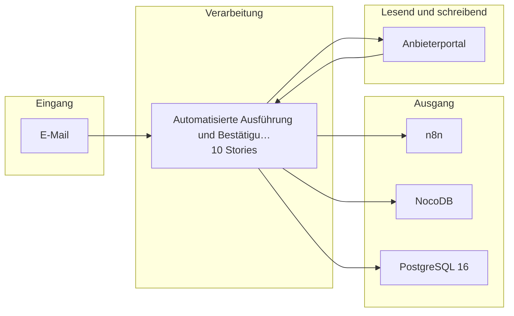

# Bauplan — kp-06

**Lieferung:** `del-kp-06-2026-10-31-090033`  
**Konzept:** `e67fe571-ecba-4d40-85e6-82a1e58d2076`  
**Erzeugt am:** 2026-10-31 durch den BC3-Slicer

> Automatisch erzeugt aus dem Ticket-Set. Nicht von Hand ändern —
> Änderungen gehen beim nächsten Lauf verloren.

## Überblick

Die Epics stehen in der Reihenfolge der Umsetzungsempfehlung von BC2. Das ist kein Ablauf.

## Komponenten

| Komponente | Rolle | Anbindung | Use Case |
|---|---|---|---|
| E-Mail | Quelle | Email | Reisestornierung automatisiert au… |
| Anbieterportal | Quelle+Ziel | API | Reisestornierung automatisiert au… |
| n8n | Ziel | API | Reisestornierung automatisiert au… |
| NocoDB | Ziel | API | Reisestornierung automatisiert au… |
| PostgreSQL 16 | Ziel | DB | Reisestornierung automatisiert au… |

## Tech-Stack laut Konzept (BC2)

- n8n (self-hosted, Hetzner) — Workflow-Orchestrierung und E-Mail-Trigger
- PostgreSQL 16 — Protokollspeicher für Vorgangsdaten
- NocoDB (self-hosted, IONOS) — strukturierte Aufgabenablage für Ausnahmen und Transparenz
- Ollama (Mistral/Llama/Qwen) — optionale LLM-gestützte Extraktion bei freitextlichen Buchungsnummer-Formulierungen
- Anthropic Claude (EU-Region, mit AVV) — Fallback für komplexe Freitextextraktion, sofern Ollama nicht ausreicht
- Grafana + Loki — Monitoring und Alerting des Workflow-Status

## Epics und Stories

### Automatisierte Ausführung und Bestätigung von Reisestornierungen

`ep-9581-6fb5-8875-abf71bf5a815`  
**Ziel:** Den vollständigen operativen Ablauf einer Reisestornierung vom Eingang des Stornowunschs bis zur abschließenden Rückmeldung automatisieren, um manuelle Eingriffe im Standardfall zu eliminieren.  
**Kategorien:** it:backend, it:integration

| Story | Titel | Akzeptanzkriterien |
|---|---|---|
| 1 | Eingehende Stornierungsanfragen per E-Mail empfangen und pr… | 2 |
| 2 | Buchungsnummer aus E-Mail extrahieren und Vollständigkeit p… | 3 |
| 3 | Stornierung beim Anbieter auslösen und Ergebnis verarbeiten | 3 |
| 4 | Bestätigungs- oder Rückfrage-E-Mail generieren und versenden | 3 |
| 5 | Vorgangsdaten lückenlos protokollieren und für Audits verfü… | 2 |
| 6 | Transparenzhinweis in Bestätigungs- und Rückfrage-E-Mails e… | 1 |
| 7 | Pseudonymisierung personenbezogener Daten vor der Protokoll… | 1 |
| 8 | Ausgabe übersteuern oder verwerfen (Art. 14 KI-VO) | 1 |
| 9 | Betrieb anhalten (Art. 14 KI-VO) | 1 |
| 10 | Aufsichtsentscheidungen protokollieren (Art. 12 und 14 KI-V… | 1 |

---

1 Epics · 10 Stories · 5 Komponenten
