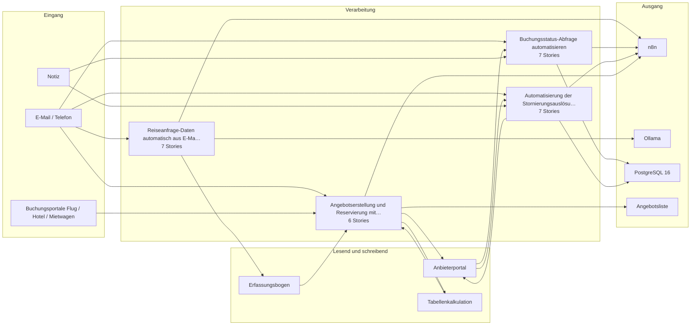

# Bauplan — kp-06

**Lieferung:** `del-kp-06-2026-11-02-172536`  
**Konzept:** `989b96f6-480f-4b6e-b603-7beff740a0cb`  
**Erzeugt am:** 2026-11-02 durch den BC3-Slicer

> Automatisch erzeugt aus dem Ticket-Set. Nicht von Hand ändern —
> Änderungen gehen beim nächsten Lauf verloren.

## Überblick

Die Epics stehen in der Reihenfolge der Umsetzungsempfehlung von BC2. Das ist kein Ablauf.

## Komponenten

| Komponente | Rolle | Anbindung | Use Case |
|---|---|---|---|
| E-Mail / Telefon | Quelle | Email | Reiseanfrage-Daten aus E-Mail ext…, Buchungsstatus-Abfrage automatisi…, Stornierungsauslösung und Bestäti…, Angebotserstellung mit Recherche-… |
| Notiz | Quelle | Manuell | Buchungsstatus-Abfrage automatisi…, Stornierungsauslösung und Bestäti… |
| Buchungsportale Flug / Hotel / Mietwagen | Quelle | API | Angebotserstellung mit Recherche-… |
| Erfassungsbogen | Ziel, Quelle | Manuell | Reiseanfrage-Daten aus E-Mail ext…, Angebotserstellung mit Recherche-… |
| Anbieterportal | Quelle, Quelle+Ziel, Ziel | API | Buchungsstatus-Abfrage automatisi…, Stornierungsauslösung und Bestäti…, Angebotserstellung mit Recherche-… |
| Tabellenkalkulation | Quelle+Ziel | Manuell | Angebotserstellung mit Recherche-… |
| n8n | Ziel | API | Reiseanfrage-Daten aus E-Mail ext…, Buchungsstatus-Abfrage automatisi…, Stornierungsauslösung und Bestäti…, Angebotserstellung mit Recherche-… |
| Ollama | Ziel | API | Reiseanfrage-Daten aus E-Mail ext… |
| PostgreSQL 16 | Ziel | DB | Buchungsstatus-Abfrage automatisi…, Stornierungsauslösung und Bestäti… |
| Angebotsliste | Ziel | Manuell | Angebotserstellung mit Recherche-… |

## Tech-Stack laut Konzept (BC2)

-  erfasst.

**Vollständigkeits-Ast:** Der befüllte Datensatz wird in die Vorgangsdatenbank (**PostgreSQL 16** oder **NocoDB**) geschrieben und dem Sachbearbeitenden als bearbeitungsreifer Vorgang zur Verfügung gestellt.

**Ausnahme-Handling:** Unterschreitet die Modell-Konfidenz einen konfigurierten Schwellwert oder enthält die Mail Anhänge, die weitere Prüfung erfordern, wird der Vorgang mit Ausnahme-Flag gesetzt und manuell zugewiesen.

**Monitoring:** Alle Verarbeitungsschritte werden in **Loki/Grafana** protokolliert; Fehlerquoten und Ausnahmeanteile sind in einem Dashboard sichtbar.
- tech_stack_empfehlung
- : [
-  n8n (Workflow-Automation, self-hosted)
-  ,
-  Ollama mit Mistral oder Qwen (LLM-Extraktion, self-hosted, EU/OSS)
-  PostgreSQL 16 (Vorgangsdatenbank)
-  NocoDB (optionale Low-Code-Oberfläche für Sachbearbeitende)
-  Grafana + Loki (Monitoring und Protokollierung)
- n8n (Workflow-Automation, self-hosted)
- Ollama mit Mistral oder Qwen (Klassifikation und Extraktion, self-hosted)
- PostgreSQL 16 (Protokollierung)
- Grafana + Loki (Monitoring)
- Ollama mit Mistral oder Qwen (Kombinations- und Bewertungslogik, self-hosted)
- NocoDB (Angebotsliste, Low-Code-Oberfläche)
- PostgreSQL 16 (Datenhaltung)

## Epics und Stories

### Reiseanfrage-Daten automatisch aus E-Mail extrahieren und prüfen

`ep-f60b-e53b-a2a0-6325a747c273`  
**Ziel:** Automatisierte Extraktion und Vollständigkeitsprüfung von Reisedaten aus E-Mail-Anfragen, um manuelle Medienbrüche zu vermeiden und die Datenqualität für die Weiterbearbeitung zu erhöhen.  
**Kategorien:** it:backend, it:integration, it:ai-pipeline

| Story | Titel | Akzeptanzkriterien |
|---|---|---|
| 1 | E-Mail-Postfach für Reiseanfragen anbinden und überwachen | 2 |
| 2 | Reisedaten aus E-Mail extrahieren und in Erfassungsbogen üb… | 3 |
| 3 | Vollständigkeitsprüfung der extrahierten Reisedaten durchfü… | 3 |
| 4 | Vollständige Vorgänge an Recherchephase übergeben | 2 |
| 5 | Verarbeitungsschritte protokollieren und überwachen | 2 |
| 6 | Ausnahmefälle bei unklaren oder widersprüchlichen Reisedate… | 1 |
| 7 | Kontaktdaten vor Extraktionsmodell pseudonymisieren | 2 |

### Buchungsstatus-Abfrage automatisieren

`ep-2561-531e-4784-e514f2e897aa`  
**Ziel:** Automatisierte Bearbeitung von Statusanfragen zu Buchungen per E-Mail, um Sachbearbeitende zu entlasten und Kunden ohne Wartezeit zu informieren.  
**Kategorien:** it:backend, it:integration, it:ai-pipeline

| Story | Titel | Akzeptanzkriterien |
|---|---|---|
| 1 | E-Mails als Statusanfragen klassifizieren und Buchungsnumme… | 3 |
| 2 | Buchungsstatus beim Anbieterportal abrufen | 3 |
| 3 | Strukturierte Antwort-Mail an Kunden senden | 2 |
| 4 | Rückfrage bei fehlender Buchungsnummer auslösen | 2 |
| 5 | Vorgänge protokollieren und eskalieren | 3 |
| 6 | Transparenzhinweis in automatisierten Antwort-Mails ergänzen | 1 |
| 7 | Transparenz und Information in Statusantwort-Mails sicherst… | 1 |

### Automatisierung der Stornierungsauslösung und Bestätigung

`ep-ebfe-6811-cd8f-7c3709593b21`  
**Ziel:** Eingehende Stornowünsche per E-Mail vollautomatisch bearbeiten, von der Erkennung bis zur Bestätigung an den Kunden, unter vollständiger Protokollierung und Eskalation von Ausnahmen.  
**Kategorien:** it:backend, it:integration, it:ai-pipeline

| Story | Titel | Akzeptanzkriterien |
|---|---|---|
| 1 | E-Mails als Stornowünsche klassifizieren und von anderen An… | 2 |
| 2 | Buchungsnummer aus E-Mails extrahieren und validieren | 2 |
| 3 | Freigabe-Schritt für Stornierungen mit menschlicher Entsche… | 2 |
| 4 | Stornierung beim Anbieterportal auslösen und Ergebnis verar… | 2 |
| 5 | Ausnahmen (Teilstornierungen, Fristüberschreitungen) erkenn… | 2 |
| 6 | Stornierungsvorgänge vollständig in der Vorgangsdatenbank p… | 1 |
| 7 | Transparenzhinweis in Stornierungsbestätigungen ergänzen | 1 |

### Angebotserstellung und Reservierung mit Recherche-Assistent unterstützen

`ep-14f7-4820-67d6-706698d024a0`  
**Ziel:** Automatisierte Aggregation und Kombination von Reiseoptionen aus Buchungsportalen, Budgetprüfung sowie nahtlose Datenübergabe zwischen Angebot und Reservierung, um manuelle Medienbrüche und Fehler zu reduzieren.  
**Kategorien:** it:backend, it:integration, it:ai-pipeline

| Story | Titel | Akzeptanzkriterien |
|---|---|---|
| 1 | Erfassungsbogen-Daten für Assistenten bereitstellen | 1 |
| 2 | Buchungsportale automatisiert abfragen und Suchergebnisse a… | 2 |
| 3 | Kombinierte Angebotsoptionen erstellen und Budget prüfen | 3 |
| 4 | Angebotsdaten manuell prüfen und freigeben | 1 |
| 5 | Angebotsdaten bei Annahme in Reservierungsformular übertrag… | 2 |
| 6 | Reservierung prüfen und freigeben | 1 |

---

4 Epics · 27 Stories · 10 Komponenten
