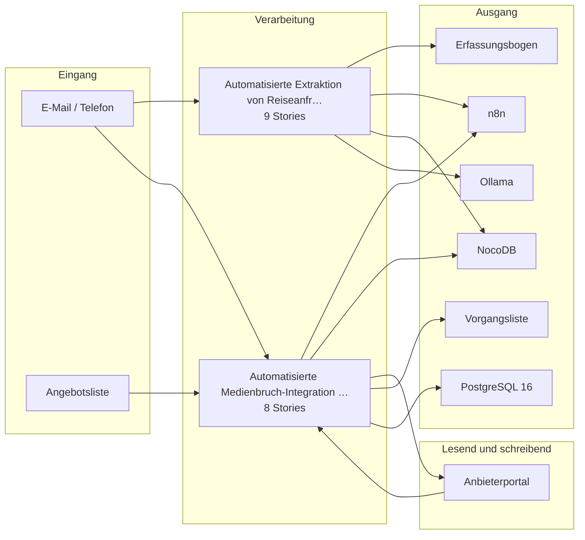

# Bauplan — kp-06

**Lieferung:** `del-kp-06-2026-11-03-184824`  
**Konzept:** `4d53e481-b332-43c7-b191-63869059afd8`  
**Erzeugt am:** 2026-11-03 durch den BC3-Slicer

> Automatisch erzeugt aus dem Ticket-Set. Nicht von Hand ändern —
> Änderungen gehen beim nächsten Lauf verloren.

## Überblick

Die Epics stehen in der Reihenfolge der Umsetzungsempfehlung von BC2. Das ist kein Ablauf.

## Komponenten

| Komponente | Rolle | Anbindung | Use Case |
|---|---|---|---|
| E-Mail / Telefon | Quelle | Email | Reiseanfrage-Extraktion aus E-Mai…, Medienbruch-Integration zwischen … |
| Angebotsliste | Quelle | Manuell | Medienbruch-Integration zwischen … |
| Anbieterportal | Quelle+Ziel | API | Medienbruch-Integration zwischen … |
| Erfassungsbogen | Ziel | Manuell | Reiseanfrage-Extraktion aus E-Mai… |
| n8n | Ziel | API | Reiseanfrage-Extraktion aus E-Mai…, Medienbruch-Integration zwischen … |
| NocoDB | Ziel | API | Reiseanfrage-Extraktion aus E-Mai…, Medienbruch-Integration zwischen … |
| Ollama | Ziel | API | Reiseanfrage-Extraktion aus E-Mai… |
| Vorgangsliste | Ziel | DB | Medienbruch-Integration zwischen … |
| PostgreSQL 16 | Ziel | DB | Medienbruch-Integration zwischen … |

## Tech-Stack laut Konzept (BC2)

- n8n (self-hosted, Hetzner) — Workflow-Orchestrierung und E-Mail-Trigger
- Ollama mit Mistral oder Qwen — lokales LLM für Feldextraktion und Rückfrage-Generierung
- NocoDB (self-hosted, IONOS) — strukturierter Erfassungsbogen und Datenhaltung
- PostgreSQL 16 — persistente Protokollierung der Extraktionsergebnisse und Freigaben
- Anthropic Claude (EU-Region, optional, nur mit AVV) — Fallback für komplexe oder mehrdeutige E-Mails
- n8n (self-hosted, Hetzner) — Workflow-Orchestrierung und Anbieteranbindung
- NocoDB (self-hosted, IONOS) — Vorgangsliste und Angebotsliste als strukturierte Datenbasis
- PostgreSQL 16 — Protokollierung aller Aktionen und Rohantworten
- K3s — Container-Betrieb des RPA-Fallback-Dienstes (Playwright)
- Ollama mit Mistral oder Qwen — optionale Klassifikation von Freitext-Portalantworten
- GitLab CI (self-hosted) — Versionierung und Deployment der Workflow-Konfigurationen

## Epics und Stories

### Automatisierte Extraktion von Reiseanfragen aus E-Mails in strukturierten Erfassungsbogen

`ep-5df5-0da1-9841-5793dbd06895`  
**Ziel:** Automatisierte Erfassung und Strukturierung von Reisedaten aus eingehenden E-Mail-Anfragen zur Reduktion manueller Übertragungsarbeit um bis zu 65 %.  
**Kategorien:** it:backend, it:integration, it:ai-pipeline

| Story | Titel | Akzeptanzkriterien |
|---|---|---|
| 1 | Pflichtfeldschema für Erfassungsbogen definieren und versio… | 1 |
| 2 | E-Mail-Postfach für eingehende Reiseanfragen überwachen | 2 |
| 3 | Reisedaten aus E-Mails extrahieren und in Erfassungsbogen e… | 4 |
| 4 | Vollständigkeitsprüfung der extrahierten Daten durchführen | 1 |
| 5 | Rückfrage-Entwürfe bei fehlenden Pflichtfeldern generieren | 2 |
| 6 | Extraktionsergebnisse revisionssicher protokollieren | 2 |
| 7 | Ausnahmefälle und manuelle Bearbeitung kennzeichnen | 1 |
| 8 | Transparenzhinweis bei E-Mail-Eingang automatisiert setzen | 1 |
| 9 | Pseudonymisierung von Kontaktdaten vor Extraktionsschritt | 1 |

### Automatisierte Medienbruch-Integration zwischen Angebotsliste, Anbieterportalen und Vorgangsliste

`ep-26d9-5ed3-1682-ce59de66b523`  
**Ziel:** Eine Integrationsschicht verbindet die interne Vorgangsliste mit Anbieterportalen, um Reservierungsnummern, Buchungsstatus und Stornierungen automatisch zu synchronisieren und Kundenbenachrichtigungen vorzubereiten.  
**Kategorien:** it:backend, it:integration

| Story | Titel | Akzeptanzkriterien |
|---|---|---|
| 1 | Strukturierte Datenbasis in NocoDB für Angebots- und Vorgan… | 1 |
| 2 | Anbieterportal-Zugriffswege prüfen und dokumentieren | 1 |
| 3 | Automatisierte Reservierung beim Anbieter anlegen und Ergeb… | 2 |
| 4 | Buchungsstatus beim Anbieter abrufen und in Vorgangsliste a… | 2 |
| 5 | Stornierungsauftrag beim Anbieter auslösen und Ergebnis in … | 3 |
| 6 | Benachrichtigungsentwürfe für Kunden erst nach Freigabe ver… | 2 |
| 7 | Hybriden Prozess für nicht automatisierbare Anbieterportale… | 1 |
| 8 | Anbieterindividuelle Konfiguration der Integrationsschicht … | 1 |

---

2 Epics · 17 Stories · 9 Komponenten
