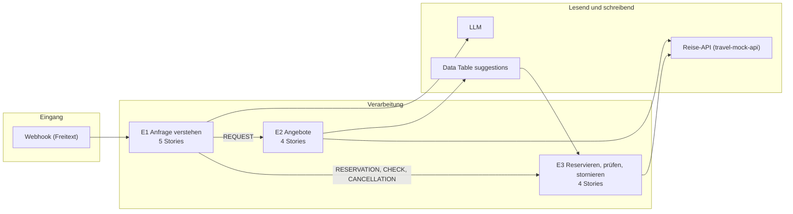

# Bauplan — uc1-reisebuchung

**Lieferung:** `del-uc1-reisebuchung-2026-10-26-test`
**Grundlage:** Zakarias Prototyp `UC1_PROTOTYPE_FULL_DATA_V3` (22.10.2026), Konzept-Bezug `1d00902e-a6dc-53a1-aed4-0221e07563a1` (BC3-Simulation, `SIM-UC1-2026-10-22`)
**Erzeugt am:** 2026-10-26, von Hand ohne BC3-Slicer

> **Testdaten.** Die Stories beschreiben, was Zakarias Prototyp tut. Ein UC1-Konzept von BC2 gibt es nicht, deshalb verweist `konzept_ref` auf BC3s simuliertes Konzept. Gate 0 und Gate 1 sind nicht durchlaufen, Gate 2 steht auf `pending`. Nur für Tests und Anforderungen von BC4 an BC0 und BC1.

## Überblick

## Menschliche Entscheidungen

- Die reisende Person wählt ein Angebot und löst die Reservierung selbst aus
- Die reisende Person löst eine Stornierung selbst aus

## Tech-Stack

- n8n — ein Webhook als Eingang, Kontext-Router mit vier Wegen
- LLM — Kontext erkennen und Reisedaten extrahieren (Prototyp: OpenAI; Konzept empfiehlt Mistral Large)
- travel-mock-api — /search/flights, /search/hotels, /search/cars, POST /reservation/create, GET /booking/snapshot, POST /booking/cancel
- n8n Data Table suggestions — gespeicherte Angebote für die Reservierung

## Epics und Stories

### E1: Reiseanfrage verstehen: Absicht erkennen, Reisedaten extrahieren, Eingaben prüfen

`ep-dbb8-51df-8132-a203e70d6f6d`  
**Ziel:** Jede Freitext-Nachricht der reisenden Person landet über einen Eingang im richtigen Weg (Suche, Reservierung, Buchung prüfen, Stornierung); bei einer Suche liegen die Reisedaten strukturiert und geprüft vor, Lücken gehen als Rückfrage zurück.  
**Kategorien:** it:integration, it:ai-pipeline

| Story | Titel | Akzeptanzkriterien | hängt ab von |
|---|---|---|---|
| E1-1 | Freitext-Anfrage über einen Webhook entgegennehmen | 1 | – |
| E1-2 | Absicht der Anfrage erkennen und Kennungen herauslesen | 3 | E1-1, E1-5 |
| E1-3 | Reisedaten aus dem Freitext extrahieren | 2 | E1-2, E1-5 |
| E1-4 | Eingaben prüfen und bei Lücken eine Rückfrage zurückgeben | 2 | E1-3 |
| E1-5 | Personenbezogene Angaben vor dem LLM-Aufruf ersetzen | 1 | E1-1 |

### E2: Reiseangebote suchen, gegen das Budget prüfen und speichern

`ep-a03c-5dd2-bae8-89e3f98fea30`  
**Ziel:** Aus einer geprüften Anfrage entstehen über die Reise-API bis zu drei Angebote mit Gesamtpreis und Budgetstatus, die gespeichert und an die reisende Person zurückgegeben werden.  
**Kategorien:** it:integration, it:backend

| Story | Titel | Akzeptanzkriterien | hängt ab von |
|---|---|---|---|
| E2-1 | Flüge, Hotels und Mietwagen parallel suchen | 2 | E1-4 |
| E2-2 | Bis zu drei Angebote zusammenstellen und gegen das Budget prüfen | 3 | E2-1 |
| E2-3 | Angebote speichern, damit sie später reserviert werden können | 1 | E2-2 |
| E2-4 | Angebote als Antwort an die reisende Person zurückgeben | 2 | E2-2, E2-3 |

### E3: Angebot reservieren, Buchung prüfen und stornieren

`ep-7203-5ca7-87e9-469048f67ae2`  
**Ziel:** Die reisende Person reserviert ein gespeichertes Angebot über die Reise-API, prüft den Status einer Buchung und storniert sie, jeweils mit eindeutiger Antwort und verständlichen Fehlern.  
**Kategorien:** it:integration, it:backend

| Story | Titel | Akzeptanzkriterien | hängt ab von |
|---|---|---|---|
| E3-1 | Gespeichertes Angebot zur Reservierung auswählen | 2 | E1-2, E2-3 |
| E3-2 | Reservierung über die Reise-API anlegen | 2 | E3-1 |
| E3-3 | Status einer Buchung prüfen | 3 | E1-2 |
| E3-4 | Buchung stornieren | 3 | E1-2 |

## Abweichungen vom Prototyp

- **E1-5 Pseudonymisierung** ist eine Ergänzung von BC3 (DSGVO Art. 25, ADR-004), der Prototyp gibt den Freitext ungefiltert an OpenAI.
- **E2-4 KI-Hinweis** in der Antwort (AI-Act Art. 50) fehlt im Prototyp.

## Offene Punkte

- **BC4:** Wie aus einer Reservierung eine Buchung mit Buchungsnummer wird (Zahlung, Bestätigung), zeigt der Prototyp nicht. Ein Endpunkt dafür fehlt im Workflow.
- **BC4 / Organisation:** LLM im Prototyp ist OpenAI; das Konzept empfiehlt Mistral Large. AVV klären oder wechseln.
- **BC2:** Für UC1 gibt es kein Konzept von BC2. Mail-Eingang, Kostenstelle, Freigabe durch die Teamleitung und Erinnerungen aus dem simulierten Konzept sind im Prototyp nicht enthalten und hier bewusst weggelassen.
- **BC3:** Risikoklasse minimal oder limited für UC1 offen (of-18).
- **IDs:** Keine echte `paket_id` aus `gate_pakete`, keine `anfrage_id`, `process_id` oder `sub_process_id` (BC0 v3.18).

---

3 Epics · 13 Stories · 4 Komponenten
